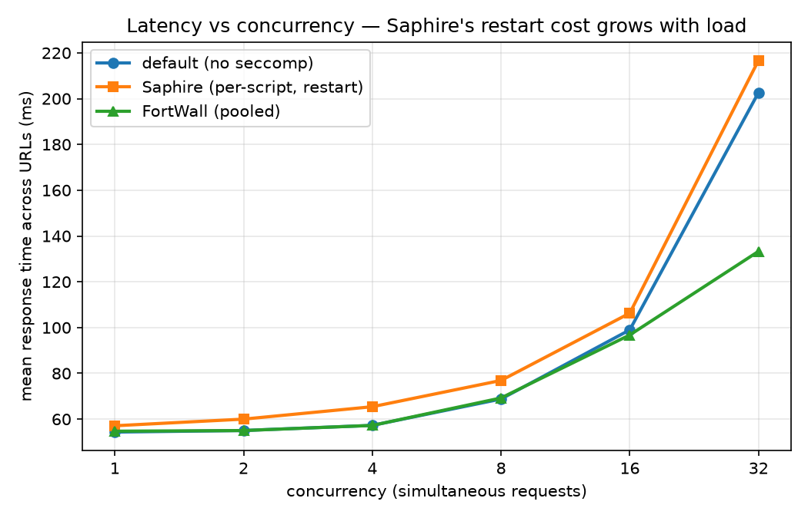
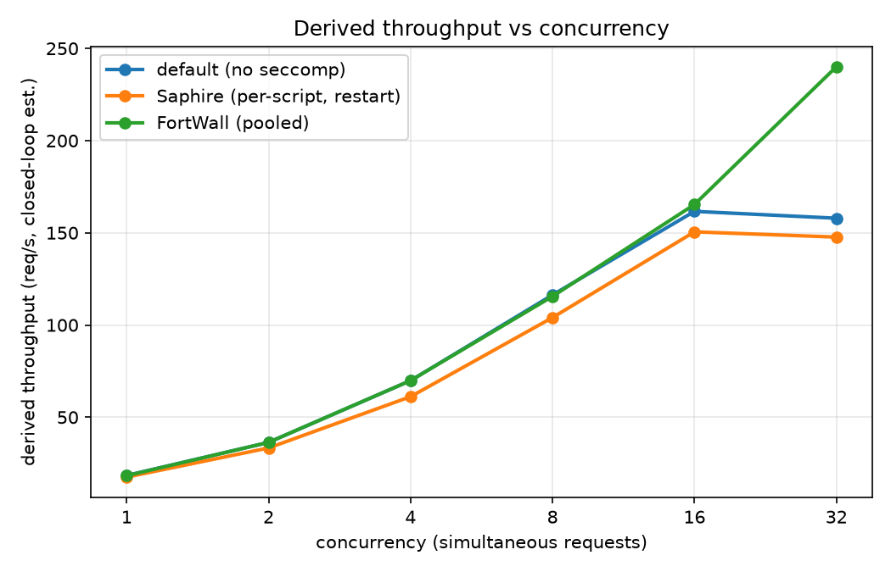
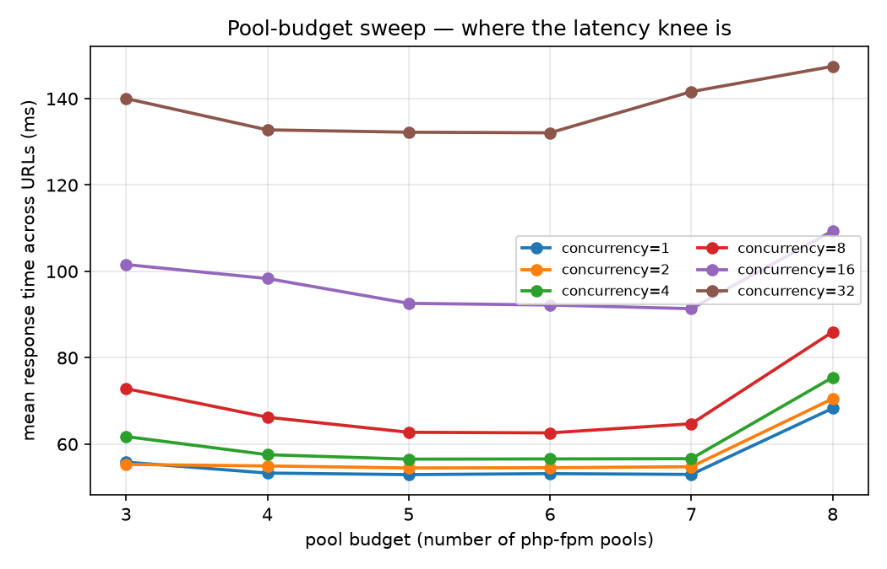

# largerun performance summary

Aggregated from `experiments/largerun/` by `aggregate.py`.

## Mean latency (ms), across URLs, per mode × concurrency

| mode | c=1 | c=2 | c=4 | c=8 | c=16 | c=32 |
|---|---|---|---|---|---|---|
| default (no seccomp) | 54.3 | 55.0 | 57.3 | 68.8 | 99.0 | 202.6 |
| Saphire (per-script, restart) | 57.1 | 60.0 | 65.4 | 76.9 | 106.3 | 216.7 |
| FortWall (pooled) | 54.7 | 55.0 | 57.3 | 69.2 | 96.8 | 133.3 |

## Pool-budget sweep — mean latency (ms)

| pools | c=1 | c=2 | c=4 | c=8 | c=16 | c=32 |
|---|---|---|---|---|---|---|
| mpool-3 | 55.8 | 55.3 | 61.8 | 72.8 | 101.6 | 140.0 |
| mpool-4 | 53.3 | 54.9 | 57.6 | 66.2 | 98.3 | 132.8 |
| mpool-5 | 52.9 | 54.5 | 56.5 | 62.7 | 92.6 | 132.2 |
| mpool-6 | 53.2 | 54.5 | 56.6 | 62.6 | 92.2 | 132.1 |
| mpool-7 | 53.0 | 54.8 | 56.6 | 64.7 | 91.4 | 141.6 |
| mpool-8 | 68.3 | 70.5 | 75.4 | 86.0 | 109.4 | 147.5 |

## Auto-flagged observations

- At concurrency=32, FortWall mean latency is 133 ms vs Saphire 217 ms — a 38% reduction from removing the per-request restart (headline result).
- Saphire↔FortWall gap widens with load: +2 ms at c=1 → +83 ms at c=32 (supports the 'restart cost scales with concurrency' narrative).
- ANOMALY TO EXPLAIN: FortWall is *faster than default* at concurrency [2, 4, 16, 32] — almost certainly pm.max_requests=0 keeping pooled workers warm vs default php-fpm recycling. Control for it (set default to the same max_requests) or explain the mechanism, or a reviewer will read it as a bug.

## Figures

## Caveats (read before putting these in the paper)

- **No tail latency.** Source CSVs hold only per-URL *means*; bigrun.py collapsed the 15k raw samples. p50/p99 need a harness change to persist raw per-request times.
- **Throughput is derived**, not measured (concurrency / mean latency). Confirm with a real load generator (wrk/ab) for the paper.
- **One app (WordPress), 7 URLs.** All perf data is WordPress; the security metrics span 11 apps but perf does not. State as a limitation or run the harness on 2–3 more apps.
- **Security (SP/SN) axis not included here.** Pair the pool-sweep latency with `fortwall analyze --app wordpress --clusters N` to draw the true perf-vs-precision Pareto.
